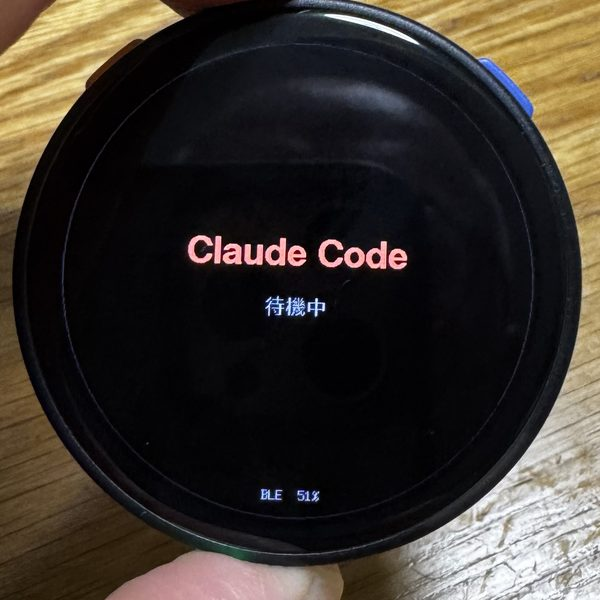
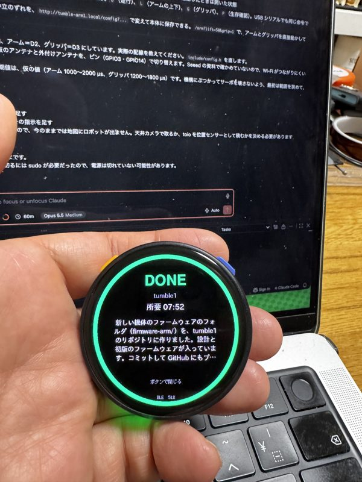
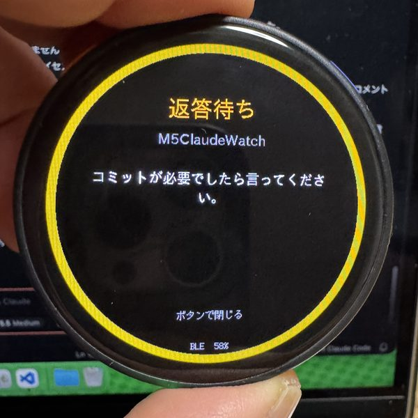
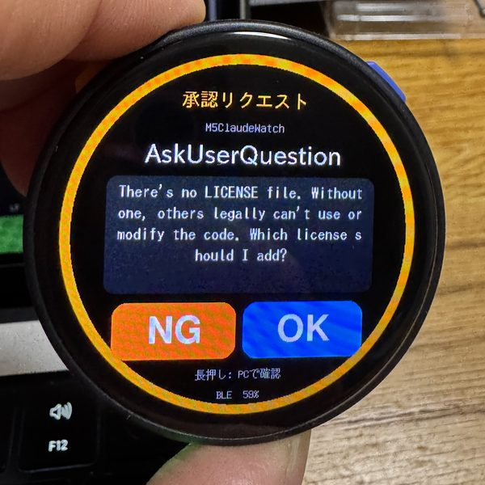

# M5ClaudeWatch

[English](README.md) | **日本語**

M5Stack StopWatch を Claude Code の手元コンパニオンにするツール。
[GOROman/vibewatch](https://github.com/GOROman/vibewatch) に触発されて作ったもので、Claude Code の hooks に直結しています。

> Anthropic とは関係のない非公式プロジェクトです。

- **作業中**: 青いリングが回転し、経過時間をストップウォッチ表示
- **完了**: 振動で通知し、所要時間と Claude の最後のメッセージを表示
- **返答待ち**: Claude の最後のメッセージが質問や依頼（「〜しますか？」「〜してください」など）で終わったら、黄色の画面と3回の短い振動で知らせ、その質問部分を表示
- **入力待ち**: Claude が入力を待っているときに通知
- **承認リクエスト**: ツール名と内容（コマンドやファイル名）を表示し、**OK / NG** をボタンまたはタッチで返す
  - 左ボタン（BtnA）または画面の NG → 拒否（Claude は中断して指示待ちになる）
  - 右ボタン（BtnB）または画面の OK → 許可
  - どちらかを長押し → 時計では答えず、PC のいつものダイアログで確認
  - 未回答のあいだは 30 秒ごとに再通知

| 待機中 | 完了 | 返答待ち | 承認リクエスト |
|:---:|:---:|:---:|:---:|
|  |  |  |  |

> **注意:** 時計の画面とメッセージは今のところ日本語のみです。Claude が英語で話す場合、「?」で終わる質問は返答待ちとして検出できますが、「Please …」のような依頼文は検出できません。対応への協力を歓迎します。ほかの言語については[他の言語への対応](#他の言語への対応)を参照してください。

```
Claude Code ──hooks──▶ m5claudewatch_hook.py ──Unix socket──▶ m5claudewatch_bridge.py ──BLE / USB──▶ StopWatch
                      (標準ライブラリのみ)               (常駐、bleak)                      (firmware/)
```

## 必要なもの

- [M5Stack StopWatch](https://docs.m5stack.com/)（ESP32-S3、466×466 円形ディスプレイ）
- macOS（ブリッジの自動起動に launchd、hook の実行に `/usr/bin/python3` を使います）
- [PlatformIO](https://platformio.org/)（ファームウェアの書き込み）
- [uv](https://docs.astral.sh/uv/)（ブリッジの実行。依存パッケージ bleak / pyserial は自動で入ります）
- Claude Code

## 構成

| パス | 内容 |
|---|---|
| `firmware/` | StopWatch 用ファームウェア（PlatformIO / M5Unified / NimBLE） |
| `host/m5claudewatch_bridge.py` | Mac で常駐するブリッジ。時計と BLE（またはシリアル）でつながる |
| `host/m5claudewatch_hook.py` | Claude Code の hook から呼ばれるスクリプト |
| `hooks/settings.example.json` | hooks の設定テンプレート |
| `install-hooks.py` | hooks を `~/.claude/settings.json` にマージする |
| `install-launchd.sh` | ブリッジをログイン時に自動起動する |

## セットアップ

### 1. ファームウェアを書き込む

StopWatch を USB-C で接続します。

```sh
cd firmware
pio run -e m5stack-stopwatch --target upload
```

### 2. ブリッジを起動する

```sh
uv run host/m5claudewatch_bridge.py          # BLE。"M5ClaudeWatch" を自動で見つけて接続
# または USB 接続のまま使う場合
uv run host/m5claudewatch_bridge.py --serial /dev/cu.usbmodemXXXX
```

初回だけ、ターミナルアプリへの Bluetooth アクセス許可を macOS が求めます。
接続した時計のアドレスは `~/.config/m5claudewatch/config.json` に保存され、以降はその時計にだけ接続します。

### 3. hooks を登録する

```sh
python3 install-hooks.py               # ~/.claude/settings.json に追加（バックアップ: settings.json.bak）
python3 install-hooks.py --uninstall   # 削除
```

登録後に起動した Claude Code セッションから有効になります。

### 4. ブリッジをログイン時に自動起動する（任意）

```sh
./install-launchd.sh                   # BLE（--serial PORT も渡せる）
./install-launchd.sh --uninstall       # 解除
tail -f ~/Library/Logs/m5claudewatch-bridge.log
```

launchd から起動した場合、ターミナルとは別に Bluetooth の許可が必要になることがあります。ログに `watch connected` が出ないときは「システム設定 > プライバシーとセキュリティ > Bluetooth」を確認してください。
**ブリッジが止まっている、または時計が未接続のときは hook は何もしない**ため、Claude Code はいつもどおり動きます。

## 設定

| 環境変数 | 既定値 | 意味 |
|---|---|---|
| `M5CLAUDEWATCH_PERM_TIMEOUT` | `110` | 時計の回答を待つ秒数。過ぎると PC のダイアログに切り替える（hook の timeout 120 秒より短くすること） |
| `M5CLAUDEWATCH_SOCKET` | `~/.claude/m5claudewatch.sock` | ブリッジのソケットのパス |

どちらも hook（Claude Code を起動するシェル）とブリッジの両方で同じ値にしてください。launchd から起動したブリッジにはシェルの環境変数が渡らないため、待ち時間を変えるときは `./install-launchd.sh --perm-timeout 60` のように引数で渡します。

効果音を鳴らしたい場合は [firmware/src/main.cpp](firmware/src/main.cpp) の `kSoundEnabled` を `true` にして書き込み直してください（既定は振動のみ）。

## 通信プロトコル

改行区切りの JSON を Nordic UART 互換の GATT サービス（`6E400001-…`）または USB シリアル（115200bps）で送ります。
詳細は [firmware/src/main.cpp](firmware/src/main.cpp) の先頭にあります。

## 他の言語への対応

言語に関わる部分は次の3か所です。言語を切り替える仕組みはまだないので、フォークして直接書き換えてください。

### 1. 返答待ちの判定（[host/m5claudewatch_hook.py](host/m5claudewatch_hook.py) の `ASK_LINE`）

Claude の返答の最後の段落で、どれかの行がこの正規表現の語で終わると「返答待ち」になります。末尾の句読点やカッコは無視します。

- 「?」「？」で終わる質問は、言語を問わず検出できます（英語、中国語、韓国語、フランス語、スペイン語など）。
- 疑問符が違う言語は検出できません（アラビア語・ペルシャ語の「؟」、ギリシャ語の「;」など）。`[?？]` に文字を足してください。
- 疑問符を使わない依頼文は、言語ごとに語を足す必要があります。日本語は「ください」「お願いします」などが入っています。
- 英語の「Please …」「Could you …」のように依頼の語が文頭に来る言語は、文末を見る `ASK_LINE` では拾えません。行頭を見る正規表現を別に足して、`asks_user()` でどちらかに一致したら返答待ちにします。

  ```python
  ASK_START = re.compile(r"^(please|could you|would you|can you|let me know)\b", re.I)
  ```

### 2. 時計の画面（[firmware/src/main.cpp](firmware/src/main.cpp)）

- **文字列:** 画面の日本語は `draw...()` の各関数と `handleMessage()` に直接書いてあります。`grep -nP '[^\x00-\x7F]' firmware/src/main.cpp` で全部見つかります。
- **フォント:** 日本語のフォント（`lgfxJapanGothic*`、`efontJA_*`）を使っています。Claude のメッセージ本文もこのフォントで表示するので、画面を日本語のままにしても、Claude が韓国語で返答するとハングルが表示されません。中国語も、日本語にない簡体字は欠けます。M5GFX には `efontCN_*`（簡体字）、`efontTW_*`（繁体字）、`efontKR_*`（韓国語）があるので、置き換えてください（10〜24px）。
- **アクセント付きの文字:** é、ñ、ü などは日本語フォントに入っていない可能性があります。実機で確認してください。
- **右から左に書く言語:** アラビア語やヘブライ語は、描画ライブラリが文字の並べ替えや字形の変化に対応していないため、正しく表示するのは難しいです。
- **折り返し:** `wrapText()` は1文字ずつ詰めて折り返します。英語のように単語をスペースで区切る言語では、単語の途中で改行されます（写真の承認リクエストの「s hould」）。スペースの位置で折り返すように変えると読みやすくなります。

### 3. hook のメッセージ（[host/m5claudewatch_hook.py](host/m5claudewatch_hook.py)）

- 「入力を待っています」: Claude Code からの通知に本文がないときに表示する文
- 「プランを承認しますか?」: プランの承認で、プランの本文がないときに表示する文
- NG を押したときに Claude に返す文: Claude はどの言語でも理解するので、変えなくても動きます

## 注意

- 承認待ちのあいだ、PC 側のダイアログが同時に出るかどうかは Claude Code のバージョンによって異なる可能性があります。時計で答えられないときは長押しで PC 側に回してください。
- BLE は現状ペアリング（暗号化）なしです。ブリッジは保存したアドレスの時計にしか接続しませんが、より厳密にしたい場合は USB シリアルで使ってください。

## ライセンス

[MIT](LICENSE)

[firmware/platformio.ini](firmware/platformio.ini) のボード設定は [GOROman/vibewatch](https://github.com/GOROman/vibewatch)（MIT License, Copyright (c) 2026 GOROman）を元にしています。
